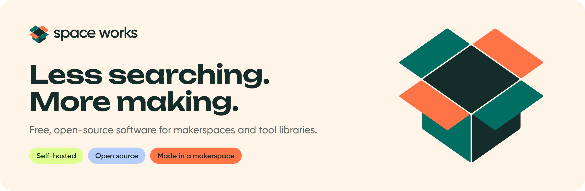
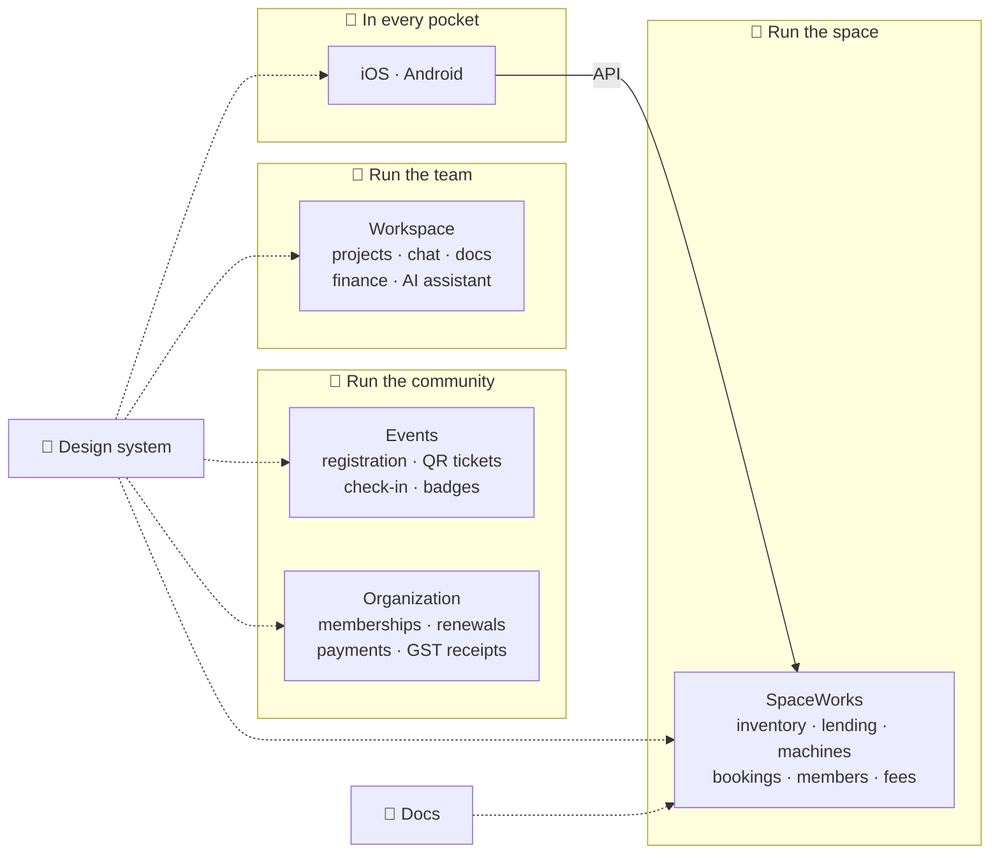

<picture>
  <source media="(prefers-color-scheme: dark)" srcset="assets/banner-dark.png">
  
</picture>

<p align="center">
  <a href="https://spaceworks-hq.github.io/SpaceWorks-Website/"><b>Website</b></a> ·
  <a href="https://spaceworks-hq.github.io/SpaceWorks-Docs/"><b>Docs</b></a> ·
  <a href="https://spaceworks-hq.github.io/SpaceWorks-Design/"><b>Design system</b></a> ·
  <a href="#-pick-your-starting-point"><b>Get started</b></a> ·
  <a href="https://github.com/SpaceWorks-HQ/.github/blob/main/CONTRIBUTING.md"><b>Contribute</b></a> ·
  <a href="https://github.com/SpaceWorks-HQ/.github/blob/main/SUPPORT.md"><b>Get help</b></a>
</p>

---

### Hey there, maker 👋

**Space Works** is a family of free, open-source, self-hosted apps for the places where things get made: **makerspaces, fab labs, hackerspaces, tool libraries, student clubs, maker communities and the young startups that grow out of them.**

One app looks after the workshop: tools, machines, bookings, members and money. The others look after everything around it: events and check-in, memberships and renewals, and the private workspace where your core team plans, talks and ships. They share one design system and one licence, and they all run on your own server. Use one or use them all, and switch on only what your space needs.

Built in a makerspace, for makerspaces. 🔩

## 🧭 Pick your starting point

| If you… | Start with |
|---|---|
| 🧰 run a **makerspace, fab lab, hackerspace or tool library** | [**SpaceWorks**](https://github.com/SpaceWorks-HQ/SpaceWorks): inventory, lending, machines, bookings, members and fees |
| 🎟️ host **meetups, workshops, hackathons or demo days** | [**SpaceWorks-Events**](https://github.com/SpaceWorks-HQ/SpaceWorks-Events): event pages, registration, live QR tickets, check-in, badges and certificates |
| 🪪 run a **club, association, chapter network or alumni body** | [**SpaceWorks-Organization**](https://github.com/SpaceWorks-HQ/SpaceWorks-Organization): plans, join forms, renewals, online and UPI payments, GST receipts and member cards |
| 🚀 lead a **community core team or an early-stage startup** | [**SpaceWorks-Workspace**](https://github.com/SpaceWorks-HQ/SpaceWorks-Workspace): an invite-only home for projects, chat, docs, files, finance and an AI assistant |
| 📱 want members to carry **the space in their pocket** | [**iOS**](https://github.com/SpaceWorks-HQ/SpaceWorks-iOS) and [**Android**](https://github.com/SpaceWorks-HQ/SpaceWorks-Android): browse and borrow tools, scan QR codes, track loans |
| 🎨 are **building on top of Space Works** | [**Design**](https://github.com/SpaceWorks-HQ/SpaceWorks-Design) and [**Docs**](https://github.com/SpaceWorks-HQ/SpaceWorks-Docs): brand, tokens, UX specs, self-hosting and API guides |

## 🗺️ The ecosystem



| | Repository | What lives there | Stack | Status |
|---|---|---|---|---|
| 🧰 | [**SpaceWorks**](https://github.com/SpaceWorks-HQ/SpaceWorks) | The core makerspace app: server, staff console, member area and one-line installer | Django, React, PostgreSQL | [](https://github.com/SpaceWorks-HQ/SpaceWorks/releases) |
| 🎟️ | [**SpaceWorks-Events**](https://github.com/SpaceWorks-HQ/SpaceWorks-Events) | Free community events: registration, live QR tickets, offline check-in, ID cards and badges | Next.js, Prisma, PostgreSQL | [](https://github.com/SpaceWorks-HQ/SpaceWorks-Events/releases) |
| 🪪 | [**SpaceWorks-Organization**](https://github.com/SpaceWorks-HQ/SpaceWorks-Organization) | Multi-tenant memberships: plans, renewals, Razorpay, Stripe and UPI, GST receipts, member ID cards | Next.js, Prisma, PostgreSQL | Active development |
| 🚀 | [**SpaceWorks-Workspace**](https://github.com/SpaceWorks-HQ/SpaceWorks-Workspace) | Private team workspace: projects and kanban, chat, docs, files, finance, blog and an assistant with MCP | Next.js, Prisma, PostgreSQL | Early build |
| 🍏 | [**SpaceWorks-iOS**](https://github.com/SpaceWorks-HQ/SpaceWorks-iOS) | Native iPhone and iPad member app, white-label | Swift, SwiftUI | In development |
| 🤖 | [**SpaceWorks-Android**](https://github.com/SpaceWorks-HQ/SpaceWorks-Android) | Native Android member app for phones and tablets, white-label | Kotlin, Compose | In development |
| 🎨 | [**SpaceWorks-Design**](https://github.com/SpaceWorks-HQ/SpaceWorks-Design) | Brand, logos, icons, fonts, light and dark design tokens and UX specs | Astro, Starlight | [Live](https://spaceworks-hq.github.io/SpaceWorks-Design/) |
| 📖 | [**SpaceWorks-Docs**](https://github.com/SpaceWorks-HQ/SpaceWorks-Docs) | Install, self-hosting, staff guides, developer guide and API reference | Astro, Starlight | [Live](https://spaceworks-hq.github.io/SpaceWorks-Docs/) |
| 🏠 | [**SpaceWorks-Website**](https://github.com/SpaceWorks-HQ/SpaceWorks-Website) | The public landing page | HTML, CSS, JS | [Live](https://spaceworks-hq.github.io/SpaceWorks-Website/) |

Everything is licensed under **AGPL-3.0**. No paid tier, no trackers, no lock-in: your members' data stays in your own database.

## 📦 What's in the core app

One install, and you switch on only the parts your space needs. Whatever you leave out simply isn't there.

| Area | What you get |
|---|---|
| 🧰 **Inventory and lending** | A public catalogue, requests, front-desk handovers and returns, QR labels and stocktake. Every handover is scanned, photographed and noted. |
| 🔧 **Machines** | A machine registry, certifications, service and 3D-print queues, and maintenance schedules. |
| 📅 **Events and bookings** | Free, invite-only or paid events with QR check-in, plus rooms and resources with recurring slots. |
| 👥 **Members** | One personal account per person, a member area for their loans and fees, and optional membership plans and renewals. |
| 💸 **Money** | Fees, deposits and receipts are always tracked. Stripe or Razorpay checkout is optional. |
| 📊 **Reports and alerts** | A report for every module, plus notifications, email and chat alerts in Telegram, Slack, Discord or Mattermost. |
| 🔐 **Running it** | Many spaces on one server, roles you define, an append-only audit log, encrypted backups, bundled Silo object storage and safe updates from GitHub releases. |

Outgrowing a module? Big event days move to **Events**, a full membership office moves to **Organization**, and your team's day-to-day moves to **Workspace**.

## 🚀 Try it on your own server

On a Linux server, as a user with `sudo`:

```bash
curl -fsSL https://raw.githubusercontent.com/SpaceWorks-HQ/SpaceWorks/main/install.sh | bash
```

The installer asks every question first and changes nothing until you confirm. Running a fork? The same command works: its first question asks which repository to install and update from. Want to look before you leap? [Read `install.sh`](https://github.com/SpaceWorks-HQ/SpaceWorks/blob/main/install.sh).

Events, Organization and Workspace each have their own Docker setup and quick start in their READMEs. The [docs](https://spaceworks-hq.github.io/SpaceWorks-Docs/) cover self-hosting, configuration and upgrades.

## 🧵 Where it all started

Space Works started at **TinkerSpace**, where I was looking after the hardware and inventory behind day-to-day making. When you're the one checking tools, finding parts and keeping things working, you quickly learn that a makerspace is more than a room full of cool machines.

It's people, access, consumables, bookings, maintenance, events, memberships, money and a hundred small details that turn a workshop into a community.

Along the way I set up a fork for TinkerSpace. That was the lightbulb moment 💡: lots of makerspaces need the same things, but not every space has the time, infrastructure or team to build a mobile app, an admin dashboard and all the systems behind them from scratch.

So why should every makerspace have to reinvent the control panel?

Today Space Works runs at **TinkerHub Kochi** and **TinkerHub Calicut**, with **1,000+ members** using it.

## 🌱 Where this is going

This isn't software for just one space. The goal is to give every makerspace, fab lab and maker community a solid starting point, so nobody has to build a whole digital ecosystem before they can get back to making.

**On the workbench 🧪**

- Publishing the iOS and Android member apps.
- Finishing Organization's membership rebuild, and Workspace's projects, chat, docs and assistant.
- More IoT integrations for tool status, access hardware and sensors. Every hardware integration gets its own docs so other spaces can copy it, change it and make it better.

We'd rather build the right tools alongside real makerspaces than ship a shiny black box. We're growing this organisation with the people and spaces who want to join in, so the opportunities that came our way can reach others too.

## 🤝 Pull up a chair

The best contributions come from people who actually use Space Works. Here's the path from "huh, that's odd" to your name in the credits:

1. **🛠️ Use it.** Install one of the apps, or run it locally with demo data. Lend a drill, book a room, check someone in, break things on purpose.
2. **🔍 Find something.** Spotted a bug, a confusing screen or a missing feature? Open an issue in that repository. Looking for somewhere to start? Browse [`good first issue`](https://github.com/search?q=org%3ASpaceWorks-HQ+label%3A%22good+first+issue%22+state%3Aopen&type=issues) and [`help wanted`](https://github.com/search?q=org%3ASpaceWorks-HQ+label%3A%22help+wanted%22+state%3Aopen&type=issues) across the organisation.
3. **🙋 Call dibs.** Comment on the issue to say you're on it, so nobody else builds the same thing.
4. **🔧 Fix it.** Fork the repo, branch off `dev` (`fix/<short-name>` or `feature/<short-name>`), make your change and run the tests.
5. **📬 Open a pull request against `dev`.** Say what changed and why, and link the issue. The PR template walks you through the rest.
6. **🎉 Get merged.** We'll review it with you, and once it's merged it ships in the next release.

The [contributing guide](https://github.com/SpaceWorks-HQ/.github/blob/main/CONTRIBUTING.md) has the house rules, and each repository's own guide has its setup steps. No CLA, no gatekeeping: contributions are shared under the project's AGPL-3.0 licence, and you keep the copyright.

**Not a coder?** You're still very welcome. Docs, translations, a fixed typo, a tested wiring diagram, design feedback and a clear bug report all help the next makerspace. **Run a makerspace, fab lab or maker community?** [Tell us how your space works](https://github.com/SpaceWorks-HQ/.github/issues/new?template=space_story.yml). We'd love to hear it.

> 🔒 Found a security issue? Please don't post it publicly. Follow the [security policy](https://github.com/SpaceWorks-HQ/.github/blob/main/SECURITY.md) to report it privately.

---

<p align="center">
  <br>
  <sub>Made with ❤️, care and probably a little filament dust, by the makers of the <b>TinkerSpace community</b>.</sub>
</p>
